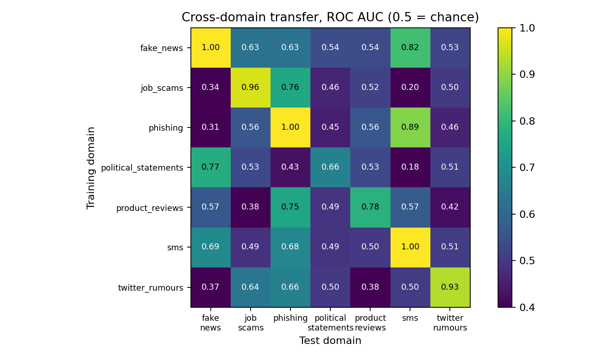

# DIFrauD deception detection

Code and results for detecting deceptive text on the DIFrauD dataset (Boumber, Qachfar, Verma, LREC-COLING 2024) from the ReDAS Lab at the University of Houston.

For each of the 7 domains, I fine-tune a BERT or RoBERTa model to tell deceptive texts from genuine ones. I report test F1 (deceptive = positive class) on the released 80/10/10 splits and compare it with the published results.

## Key findings

- **What I found.** Plain fine-tuning of BERT and RoBERTa on all 7 domains matches the plain fine-tuning mean in Table 2 of the paper (0.8398 vs 0.8399). I did not build the adapter methods, which have a higher mean (PreXIA, 0.8635).
- **What is uncertain.** On Political and Job scams I am below the paper, but the paper's number is inside my 95% interval, so the gap may be noise. On Political, F1 is a weak score: answering "deceptive" for every text gives 0.783. A detector trained on one domain mostly does not work on another (mean AUC 0.53, one run per source domain).
- **What I would do next.** See "Next steps" at the end.

## Dataset

DIFrauD has about 96,000 English texts in 7 domains: SMS, phishing, fake news, product reviews, Twitter rumours, political statements and job scams. Each text has a binary label (1 = deceptive, 0 = genuine). The train, validation and test splits are the ones released with the dataset (seed 42).

## Terms

- **F1**: a score from 0 to 1 that balances false alarms and missed deceptive texts. Higher is better.
- **Trivial F1**: the F1 of a classifier that answers "deceptive" for every text. It shows how little a model has learned if it scores close to it.
- **AUC / AP**: scores that measure how well the model ranks deceptive texts above genuine ones. They do not depend on a threshold. AUC of 0.5 is chance.
- **Threshold**: the probability above which the model answers "deceptive". It is 0.5 unless stated.
- **CI**: 95% bootstrap confidence interval on the test set. It covers test-sampling noise only, not training randomness.
- **Ensemble**: the average of the predicted probabilities of several runs with different seeds.

## Results

| Domain | Model | Runs | Test F1 @0.5 [95% CI] | Trivial F1 | AUC | AP | Paper fine-tune |
|---|---|---|---|---|---|---|---|
| SMS | BERT-base | 3 (ensemble) | 0.9883 [0.974, 1.000] | 0.326 | 1.000 | 0.998 | 0.9883 |
| Phishing | BERT-base | 3 (ensemble) | 0.9893 [0.983, 0.994] | 0.569 | 1.000 | 0.999 | 0.9859 |
| Fake news | BERT-base | 3 (ensemble) | 0.9852 [0.979, 0.991] | 0.603 | 0.998 | 0.998 | 0.9773 |
| Product reviews | BERT-base | 3 (ensemble) | 0.7197 [0.698, 0.740] | 0.667 | 0.787 | 0.797 | 0.6968 |
| Twitter rumours | RoBERTa-base | 3 (ensemble) | 0.8199 [0.775, 0.860] | 0.508 | 0.939 | 0.898 | 0.7944 |
| Political statements | BERT-base | 3 (ensemble) | 0.7427 [0.718, 0.765] | 0.783 | 0.673 | 0.773 | 0.7640 |
| Job scams | RoBERTa-base | 3 (ensemble) | 0.6337 [0.511, 0.738] | 0.081 | 0.962 | 0.725 | 0.6729 |

Every row is an ensemble: the average of the probabilities of 3 runs (seeds 42, 1 and 2). The individual runs average (mean ± std): SMS 0.9870 ± 0.002, Phishing 0.9868 ± 0.001, Fake news 0.9841 ± 0.001, Product reviews 0.7157 ± 0.006, Twitter 0.8205 ± 0.008, Political 0.7326 ± 0.013, Job scams 0.6329 ± 0.060. All seed runs are used, whatever their scores. The full table is in `results_pred/analysis.md`.

Summary:
- The mean F1 over the 7 domains is 0.8398, level with the paper's plain fine-tuning (0.8399).
- F1 is equal or higher than the paper's plain fine-tuning on 5 of 7 domains. On Twitter, Political and Job scams the paper's number is inside my confidence interval, so no difference can be claimed.
- Political statements is close to chance for text-only models (AUC about 0.67). The trivial classifier scores 0.783, higher than my result and higher than the paper's 0.764, so F1 is a weak measure for this domain.
- Job scams ranks well (AUC 0.96), but F1 is limited because the test set has only 60 deceptive texts and some are missed with high confidence (see Error analysis).

## Comparison with published results

The IWSPA 2024 paper "LLMs for Explainable Few-shot Deception Detection" (Boumber, Tuck, Verma, Qachfar) uses the same splits and repeats the baselines of the COLING 2024 paper. The rows below are copied from its Table 2. "Mean" is the plain average over the 7 domains.

| Method | Pols | News | Jobs | Prod | Phish | Twitter | SMS | Mean |
|---|---|---|---|---|---|---|---|---|
| This work (BERT / RoBERTa fine-tuned) | 0.7427 | 0.9852 | 0.6337 | 0.7197 | 0.9893 | 0.8199 | 0.9883 | 0.8398 |
| Paper: fine-tuned bert-base-uncased | 0.7640 | 0.9773 | 0.6729 | 0.6968 | 0.9859 | 0.7944 | 0.9883 | 0.8399 |
| Paper: RADDICL-3 (4-shot LLM) | 0.7786 | 0.8867 | 0.6606 | 0.4058 | 0.9769 | 0.8511 | 0.7475 | 0.7582 |
| Paper: PreXIA + BERT (adapter) | 0.7881 | 0.9881 | 0.7350 | 0.7206 | 0.9896 | 0.8511 | 0.9723 | 0.8635 |

- Against plain fine-tuning: higher on fake news, product reviews and Twitter, level on SMS and phishing, lower on Political and Job scams.
- Against RADDICL-3: higher on fake news, product reviews, phishing and SMS; lower on Political, Job scams and Twitter.
- Against PreXIA: lower in the mean. The adapter methods (PreXIA, MAM, UniPELT) and the LLM system were not reimplemented here.
- On Political statements, the all-deceptive answer (0.783) is above most rows. Only some adapter rows are above it, narrowly (MAM 0.7841, PreXIA 0.7881).
- Counts: the paper gives 599 deceptive job scams (60 in a 10% test split), which matches this test set. For phishing, the IWSPA text mentions 14,219 texts (about 1,422 in the test split). The dataset page lists 15,272 texts with a test split of 1,528, which is the size used here.
- The other IWSPA 2024 paper (Hanks et al., LIWC features) uses different data, a Random Forest, 5-fold cross-validation and weighted F1. It is not comparable and was not reproduced.

## Why two domains are below the paper

Political statements (0.7427 vs 0.7640) and Job scams (0.6337 vs 0.6729) are below the paper's plain fine-tuning row. What I know:

- **The gap is not clearly real.** In both domains the paper's number is inside my 95% confidence interval. On Job scams, two runs of the same code gave 0.6465 and 0.6139, so a gap of 0.04 is within the change between runs.
- **Political statements:** F1 is a weak measure here. AUC is only about 0.67, and the all-deceptive answer scores 0.783, higher than both my result and the paper's. Most of the confident false alarms mention Obama or Obamacare. I tested this with the TF-IDF model: removing its top 20 "deceptive" words (including obamacare and obama) did not lower F1 or AUC more than removing 20 random words (see "Shortcut test"). So there is no sign of a topic shortcut in TF-IDF; I did not test BERT.
- **Job scams:** the test set has only 60 deceptive texts. The model missed 29 of them, and many read like normal job ads. This may be label noise (not verified).
- **What I tried:** longer inputs and more epochs, class weights, undersampling, RoBERTa, a higher learning rate, and threshold tuning (see "What was tried"). I kept the best setting on validation for each domain.
- **What I did not do:** tune on the test set. The only gain I saw (Political 0.783 with threshold tuning) is the same as the trivial answer, so I do not count it. I also did not use a larger model or build the adapter methods. I do not know how much the paper's number moves between runs.

## Extra (not part of the task): cross-domain transfer

Question (from my first email to Prof. Verma): if a detector is trained on one domain, does it work on another? I trained one BERT-base model per source domain (seed 42, same fixed settings as before) and scored it once on the test set of every other domain. Nothing was tuned on the target domains. The main score is ROC AUC, because the share of deceptive texts is very different between domains. Code: `run_transfer.sh`, `src/transfer.py`. Results: `results_transfer/` (F1 at 0.5 is in `transfer.md`).

Rows = training domain, columns = test domain. The diagonal (bold) is the normal in-domain test. 0.5 is chance.

| Train on \ Test on | fake_news | job_scams | phishing | political_statements | product_reviews | sms | twitter_rumours |
|---|---|---|---|---|---|---|---|
| fake_news | **0.998** | 0.628 | 0.629 | 0.543 | 0.537 | 0.818 | 0.525 |
| job_scams | 0.338 | **0.963** | 0.758 | 0.462 | 0.516 | 0.199 | 0.501 |
| phishing | 0.314 | 0.562 | **0.999** | 0.451 | 0.562 | 0.888 | 0.459 |
| political_statements | 0.772 | 0.531 | 0.427 | **0.664** | 0.532 | 0.177 | 0.512 |
| product_reviews | 0.566 | 0.384 | 0.752 | 0.490 | **0.784** | 0.574 | 0.421 |
| sms | 0.685 | 0.486 | 0.677 | 0.492 | 0.499 | **1.000** | 0.510 |
| twitter_rumours | 0.375 | 0.636 | 0.664 | 0.500 | 0.382 | 0.504 | **0.931** |



What the table shows:
- **Transfer is weak.** Over the 42 off-diagonal pairs the mean AUC is 0.529 (median 0.514), close to chance.
- **Only 5 of 42 pairs reach 0.70:** phishing to SMS 0.888, fake news to SMS 0.818, political statements to fake news 0.772, job scams to phishing 0.758, product reviews to phishing 0.752.
- **9 pairs are below 0.45, and two are about 0.18 to 0.20** (political statements to SMS 0.177, job scams to SMS 0.199). Here the ranking is reversed: texts that look deceptive to the source model are more often genuine in the target. This may mean that the label has a different meaning in different domains (for example, spam in SMS may not mean the same as deception elsewhere), or that cues point in opposite directions. I did not test this.
- **No identical text is shared** between a training domain and a different test domain, so copied texts do not inflate these numbers.

Limits: one run per source domain (seed 42) and no confidence intervals. I measured whether a detector transfers, not which cues transfer. F1 at 0.5 is hard to compare here because the share of deceptive texts differs by domain, so AUC is the main score.

## Baseline: TF-IDF + logistic regression

A simple model that counts words and word pairs, with no pre-trained language model. Settings were fixed before looking at results (C=4) and not tuned on test. One run per domain, no CI. Run with `python -m src.tfidf`.

| Domain | TF-IDF F1 @0.5 | TF-IDF F1 @val-tuned thr | AUC | AP | Transformer F1 @0.5 |
|---|---|---|---|---|---|
| SMS | 0.9606 | 0.9572 | 0.998 | 0.993 | 0.9883 |
| Phishing | 0.9758 | 0.9792 | 0.999 | 0.998 | 0.9893 |
| Fake news | 0.9338 | 0.9324 | 0.986 | 0.980 | 0.9852 |
| Product reviews | 0.6526 | 0.6966 | 0.720 | 0.722 | 0.7197 |
| Twitter rumours | 0.8043 | 0.8116 | 0.940 | 0.897 | 0.8199 |
| Political statements | 0.7523 | 0.7838 | 0.650 | 0.761 | 0.7427 |
| Job scams | 0.4810 | 0.6292 | 0.952 | 0.729 | 0.6337 |

A paired bootstrap on the same test texts (`python -m src.paired results_pred`, 2000 resamples, threshold 0.5) gives the 95% interval of F1(transformer) minus F1(TF-IDF):

| Domain | Difference | 95% CI | Real difference? |
|---|---|---|---|
| SMS | +0.028 | [+0.006, +0.052] | yes, transformer better |
| Phishing | +0.014 | [+0.004, +0.022] | yes, transformer better |
| Fake news | +0.051 | [+0.040, +0.064] | yes, transformer better |
| Product reviews | +0.067 | [+0.046, +0.091] | yes, transformer better |
| Political statements | -0.010 | [-0.030, +0.011] | no |
| Twitter rumours | +0.016 | [-0.026, +0.058] | no |
| Job scams | +0.153 | [+0.038, +0.285] | yes at 0.5, but see below |

- Job scams: the gap at 0.5 comes mostly from TF-IDF's poorly scaled probabilities. With thresholds chosen on validation, both models reach about the same F1 (TF-IDF 0.629, transformer 0.628), and AP is 0.729 vs 0.725.
- The intervals cover test-sampling noise only. All transformer rows are 3-seed ensembles; TF-IDF is a single model.
- On Product reviews, TF-IDF at 0.5 (0.653) is below the trivial classifier (0.667).
- The highest-weight words suggest possible shortcuts (hypotheses, not proof): event names in Twitter (charliehebdo, ferguson); enron, dnc, 2001 and 2002 as "genuine" words in phishing, so the two classes may come from different sources; obamacare in Political (tested below for Political only; the Twitter and phishing ideas are not tested).


## Shortcut test (Political statements, TF-IDF)

Question: does the simple model depend on its top "deceptive" words? I removed the 20 single words with the largest "deceptive" weights (obamacare, work, liberal, democrats, white, idea, over, stimulus, wisconsin, ethics, face, china, president, lost, obama, began, changed, supports, will, policies) from all texts, refit, and scored the test set. Control: 20 random words of similar frequency removed, 5 repeats. Run with `python -m src.shortcut --domain political_statements --k 20`.

| Setting | F1 @0.5 | AUC |
|---|---|---|
| TF-IDF, all words | 0.7523 | 0.650 |
| Top 20 words removed | 0.7537 | 0.646 |
| 20 random words removed (mean of 5) | 0.7512 | 0.650 |

Removing the top words did not hurt more than removing random words (F1 +0.001, AUC -0.003). So there is no sign that this model leans on obamacare or the other top words; its weak signal (AUC 0.65) is spread over many words. Limits: TF-IDF only (not BERT), one domain, one run. It does not prove that BERT has no shortcut.

## What was tried

Models were chosen on validation F1 only. The test split was scored once per run. Numbers are validation F1. In every run, the model after the last epoch (epoch 3) is the one that is scored. I did not pick a "best epoch", and no checkpoints are saved.

| Setup | Job scams | Political | Twitter |
|---|---|---|---|
| BERT-base, 256 tokens, 3 epochs (default) | 0.7395 | 0.7393 | 0.8208 |
| BERT-base, 512 tokens, 5 epochs (paper's length and epochs) | 0.7395 | 0.7104 | 0.8309 |
| BERT-base, class-weighted loss | 0.7328 | 0.6671 | 0.7991 |
| RoBERTa-base | 0.7500 | 0.7206 | 0.8298 |
| BERT-base, learning rate 5e-5 | n/a | 0.7083 | 0.8284 |

Final choice: BERT-base (default) for fake news, phishing, product reviews, SMS and political statements; RoBERTa-base (default) for Job scams and Twitter. Settings: learning rate 2e-5, 3 epochs, batch size 32, max length 256, fp16.

What did not work:
- Class-weighted loss lowered validation F1 on all three domains and made training unstable (very large gradients on Job scams).
- Undersampling the majority class (Job scams, 958 training texts) gave validation F1 of 0.25 to 0.39, far below plain training (0.74 to 0.76). Tuning the threshold raised it to 0.49 to 0.65, still lower.
- Tuning the threshold on validation did not help on Job scams or Twitter. On Political statements it raised F1 from 0.743 to 0.783, but at threshold 0.17 the model flags almost every text (407 of 445 genuine texts are false positives). That equals the trivial classifier, so it is not a real gain.

## Error analysis

These are hypotheses and were not verified.
- Job scams: at threshold 0.5, 29 of 60 deceptive test texts were missed, often with probability near 0, and many read like normal job ads. Some texts labeled genuine contain classic scam cues. This suggests label noise or cues outside the text.
- Political statements: 11 of the 15 most confident false positives mention Obama or Obamacare, but the shortcut test on TF-IDF did not show a dependence on these words (see "Shortcut test"). Missed deceptive texts are mostly neutral statistics.
- Product reviews: the IWSPA 2024 LLM paper (Section 5.3) suspects the models pick up the style of the crowd workers who wrote part of the deceptive reviews. This was not tested here.

## Data checks

- Source: on 4 Nov 2026 I compared all 21 `.jsonl` files of the official repo `redasers/difraud` with the files used here from `difraud/difraud`. They are byte-identical (same SHA-256).
- Job scams: no text appears in both train and test.
- Phishing (`python -m src.overlap --domain phishing`, prints counts only):
  - 14 of 1,528 test texts are identical (exact match on `text`) to a train text, all with the same label. Removing them changes test F1 of the seed-42 run from 0.9860 to 0.9857.
  - Train has 79 extra copies of texts already in train, with no label conflicts.
  - Ignoring case, spacing and links gives 20 test texts in train and 101 extra train copies, again with no label conflicts.
  - The dataset page says duplicates within a domain were dropped, but a few identical texts remain by these checks. The test split was left unchanged so scores stay comparable with the paper.

## Limitations

- GPU training is not bit-for-bit repeatable, even with fixed seeds. Job scams (RoBERTa, seed 42) gave test F1 0.6465 and 0.6139 on two runs.
- All 7 domains have 3 seeds (42, 1, 2) and the reported numbers are their ensembles. Three seeds are still few, so the seed spread is only a rough guide.
- The confidence intervals do not include training randomness or threshold selection.
- Only BERT-base and RoBERTa-base were tested.

## Usage

Tested on Google Colab (T4 GPU, Python 3.13).

Library versions in the Colab session of the latest runs (3-seed runs and cross-domain transfer): Python 3.13.16, torch 2.11.0+cu130, transformers 4.46.3, numpy 2.4.6, scikit-learn 1.6.1. `transformers`, `accelerate` and `huggingface_hub` are pinned in `requirements.txt`; the others come from Colab. Every result file records its own torch and transformers versions.

```
pip install -r requirements.txt
# data_manifest.json is in the repo. Do not re-pin it, so you use the same dataset version.
python -m src.train --domain sms                                   # quick check, test F1 near 0.99
bash run_all.sh google-bert/bert-base-uncased "42"                 # all 7 domains
python -m src.train --domain job_scams --model FacebookAI/roberta-base --seed 42 --out results_pred
python -m src.analyze results_pred                                 # table with CIs, AUC, trivial F1
python -m src.threshold results_pred                               # validation-chosen thresholds
python -m src.errors --domain job_scams --run results_pred/<file>.json --kind fn --n 25
python -m src.dupes --domain phishing --run results_pred/<file>.json
python -m src.overlap --domain phishing                            # repeated-text check
python -m src.shortcut --domain political_statements --k 20   # shortcut test (TF-IDF, CPU)
python -m pytest -q tests                                          # unit tests
bash make_report.sh                                                # rebuild all tables and the figure (no GPU needed)
```

`make_report.sh` also saves the library versions it used to `results_pred/versions.txt` (python, torch, transformers, numpy, scikit-learn).

`python -m src.data pin` creates `data_manifest.json`: the dataset commit (`aaaf94b336c563a14806bb4f3f58727bed9ed8d4`) and a SHA-256 for each file.

## Security

The dataset contains real scam and phishing texts, so it is treated as untrusted.

- Texts are only parsed with `json.loads` and tokenized. They are never executed, opened or rendered. Printed examples have links defanged (`hxxp`). Do not click or open anything in them.
- Only the plain `.jsonl` files are downloaded. The dataset repo's loading script is never run.
- Hugging Face's scanner marks three files in the dataset repo (the files in the `phishing/` folder; the other six domains are not flagged) as unsafe. They contain real phishing emails, which can trigger a pattern match on links or scripts. They are only parsed as text on a temporary Colab machine, and no dataset file is stored in this repository. Do not download the data files to a personal computer or open them in a browser or editor.
- The dataset version is pinned by commit, and each file is checked against its SHA-256 before use.
- Models load as `safetensors` only (no pickle), `trust_remote_code` is off, and only two models are allowed.
- No checkpoints are saved. Saved prediction files contain labels and scores only, never texts.
- No tokens or secrets are used. Data, model files and keys are excluded by `.gitignore`.

## Repository layout

```
src/            data.py, train.py, analyze.py, threshold.py, errors.py, dupes.py, overlap.py,
                aggregate.py, tfidf.py, paired.py, figure.py, transfer.py, shortcut.py
tests/          unit tests (pytest)
results*/       one JSON per run (metrics, settings, library versions, saved scores)
results_pred/   final runs with saved predictions, plus analysis.md
results_tfidf/  TF-IDF baseline results
results_transfer/  cross-domain transfer results (transfer.md, transfer_auc.png, one JSON per source domain)
data_manifest.json   pinned dataset version and file hashes
run_all.sh      runs all 7 domains
make_report.sh  rebuilds all tables and the figure from saved runs
run_transfer.sh cross-domain experiment; results in results_transfer/
```

## Next steps

- **Test the shortcut ideas further.** I only tested Political with TF-IDF. Next: the same masking test on BERT, and on Twitter (event names) and phishing (source names), then evaluate with splits by event or source.
- **Find which cues transfer.** Several seeds with intervals, leave-one-domain-out training, and simple linguistic features against learned features.
- **Check label quality.** Look for confident disagreements between models and labels, and have experts review a small sample. Job scams first.
- **Try stronger methods under the same rules.** Adapter methods, larger models and the explainable few-shot LLM approach, same splits, same seed protocol, choices made on validation data only.
- **Report better.** Trivial baseline, AUC and AP next to F1 in every table; thresholds chosen from the cost of a missed scam against a false alarm.
