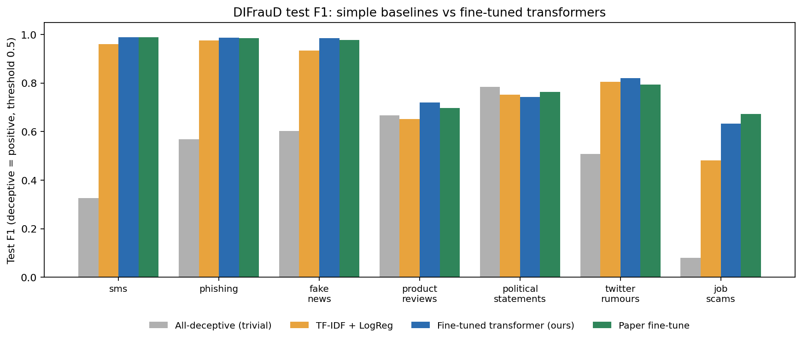

# DIFrauD deception-detection baselines

A reproducible pipeline for the DIFrauD benchmark (Boumber, Qachfar, Verma, LREC-COLING 2024): fine-tune a transformer on each of the 7 domains and report binary F1 with "deceptive" as the positive class, on the released 80/10/10 splits. Results are compared with the paper's Table 2.

**Scope.** This repo compares only with the LREC-COLING 2024 paper (plain fine-tuning row, "finetune, tgt"). I have not compared with the IWSPA 2024 papers. The paper numbers in this README were transcribed from Table 2 and should be checked against the PDF.

## Results

Test-set binary F1 (deceptive = positive). "Trivial F1" is the score of a classifier that predicts "deceptive" for every text. AUC and AP do not depend on a threshold. CI = 95% bootstrap interval on the test set (it covers test-sampling noise only, not training randomness).

| Domain | Model | Runs | Test F1 @0.5 [95% CI] | Trivial F1 | AUC | AP | Paper fine-tune |
|---|---|---|---|---|---|---|---|
| SMS | BERT-base | 1 | 0.9883 [0.974, 1.000] | 0.326 | 1.000 | 0.999 | 0.9883 |
| Phishing | BERT-base | 1 | 0.9860 [0.979, 0.992] | 0.569 | 0.999 | 0.999 | 0.9859 |
| Fake news | BERT-base | 1 | 0.9841 [0.978, 0.990] | 0.603 | 0.997 | 0.998 | 0.9773 |
| Product reviews | BERT-base | 1 | 0.7192 [0.698, 0.740] | 0.667 | 0.784 | 0.795 | 0.6968 |
| Twitter rumours | RoBERTa-base | 3 (ensemble) | 0.8199 [0.775, 0.860] | 0.508 | 0.939 | 0.898 | 0.7944 |
| Political statements | BERT-base | 3 (ensemble) | 0.7427 [0.718, 0.765] | 0.783 | 0.673 | 0.773 | 0.7640 |
| Job scams | RoBERTa-base | 3 (ensemble) | 0.6337 [0.511, 0.738] | 0.081 | 0.962 | 0.725 | 0.6729 |

Single-run rows use seed 42. "Ensemble" rows average the predicted probabilities of seeds 42, 1 and 2. Mean ± std of the individual runs at threshold 0.5: Twitter 0.8205 ± 0.008, Political 0.7326 ± 0.013, Job scams 0.6329 ± 0.060. The full table is in `results_pred/analysis.md`.

**How to read this**
- Matches or exceeds the paper's plain fine-tuning on 5 of 7 domains. On Twitter, Political and Job scams the paper's number lies inside the confidence interval, so no difference can be claimed.
- Political statements is near chance for text-only models: AUC about 0.67, and the trivial classifier (0.783) beats every default-threshold result here. The paper's own fine-tune score (0.764) is also below that trivial score, so F1 on the deceptive class is a weak measure in this domain.
- Job scams has strong ranking (AUC 0.96) but F1 is limited by only 60 deceptive test texts and by confident errors (see below).

## Simple baseline: TF-IDF + logistic regression

CPU-only baseline (`python -m src.tfidf`): word 1-2-grams, logistic regression with fixed settings (C=4, chosen before seeing results, not tuned on test). One run per domain, no confidence interval. `python -m src.figure results_pred results_tfidf/tfidf.json` draws `summary.png`.

| Domain | TF-IDF F1 @0.5 | TF-IDF F1 @val-tuned thr | AUC | AP | Transformer F1 @0.5 |
|---|---|---|---|---|---|
| SMS | 0.9606 | 0.9572 | 0.998 | 0.993 | 0.9883 |
| Phishing | 0.9758 | 0.9792 | 0.999 | 0.998 | 0.9860 |
| Fake news | 0.9338 | 0.9324 | 0.986 | 0.980 | 0.9841 |
| Product reviews | 0.6526 | 0.6966 | 0.720 | 0.722 | 0.7192 |
| Twitter rumours | 0.8043 | 0.8116 | 0.940 | 0.897 | 0.8199 |
| Political statements | 0.7523 | 0.7838 | 0.650 | 0.761 | 0.7427 |
| Job scams | 0.4810 | 0.6292 | 0.952 | 0.729 | 0.6337 |

- A paired bootstrap on the same test texts (`python -m src.paired results_pred`, 2000 resamples, threshold 0.5 for both) gives the 95% interval of F1(transformer) - F1(TF-IDF):

| Domain | Difference | 95% CI | Real difference? |
|---|---|---|---|
| SMS | +0.028 | [+0.006, +0.052] | yes, transformer better |
| Phishing | +0.010 | [+0.001, +0.020] | borderline, transformer slightly better |
| Fake news | +0.050 | [+0.039, +0.062] | yes, transformer better |
| Product reviews | +0.067 | [+0.045, +0.090] | yes, transformer better |
| Political statements | -0.010 | [-0.030, +0.011] | no |
| Twitter rumours | +0.016 | [-0.026, +0.058] | no |
| Job scams | +0.153 | [+0.038, +0.285] | yes at threshold 0.5, but see below |

- Job scams: the gap at 0.5 comes mostly from TF-IDF's poor calibration. With thresholds tuned on validation, both models reach about the same F1 (TF-IDF 0.629, transformer ensemble 0.628), and AP is 0.729 vs 0.725, so the two rank texts about equally well.
- The intervals cover test-sampling noise only, not training randomness. The transformer rows for Political, Twitter and Job scams are 3-seed ensembles; TF-IDF is a single model.
- Product reviews at threshold 0.5 (0.653) is below the trivial classifier (0.667).
- Words with the largest weights suggest possible shortcuts (hypotheses, not proof): Twitter weights are event names (e.g. charliehebdo, ferguson); phishing "genuine" weights include enron, dnc, 2001/2002 (the genuine and phishing emails may come from different sources); Political weights include obamacare, as in the transformer errors.



## What was tried

Model choice was made on validation F1 only; the test split was scored once per run.

| Setup | Job scams val F1 | Political val F1 | Twitter val F1 |
|---|---|---|---|
| BERT-base, 256 tokens, 3 epochs (default) | 0.7395 | 0.7393 | 0.8208 |
| BERT-base, 512 tokens, 5 epochs (paper's length and epochs) | 0.7395 | 0.7104 | 0.8309 |
| BERT-base, class-weighted loss | 0.7328 | 0.6671 | 0.7991 |
| RoBERTa-base | 0.7500 | 0.7206 | 0.8298 |
| BERT-base, learning rate 5e-5 | n/a | 0.7083 | 0.8284 |

Final configs: BERT-base default for fake news, phishing, product reviews, SMS and political statements; RoBERTa-base default for Job scams and Twitter. Hyperparameters: learning rate 2e-5, 3 epochs, batch size 32, max length 256, fp16.

**What did not work**
- *Class-weighted loss* lowered validation F1 on all three domains and made training unstable (very large gradient norms on Job scams).
- *Undersampling the majority class* (Job scams, 958 training texts) gave validation F1 of 0.25 to 0.39, far below plain training (0.74 to 0.76). Choosing the threshold on validation raised it to 0.49 to 0.65, still well below. The training set shrinks by about 90% and the class mix no longer matches the data.
- *Tuning the decision threshold on validation* helped nothing on Job scams and Twitter. On Political statements it raised F1 from 0.743 to 0.783, but at threshold 0.17 the model flags almost every text as deceptive (407 of 445 genuine texts are false positives). That equals the trivial classifier's 0.783, so it is not a real improvement.

## Error analysis (hypotheses, not verified)

- *Job scams.* At threshold 0.5, 29 of 60 deceptive test texts were missed, often with probability near 0, and many of them read like ordinary job ads. Some texts labeled genuine contain classic scam cues. This suggests label noise or cues outside the text. I have not verified how the labels were produced.
- *Political statements.* 11 of the 15 highest-confidence false positives mention Obama or Obamacare, which suggests a topic shortcut. The missed deceptive texts are mostly neutral statistics.

## Data checks

- No text appears in both train and test for Job scams.
- Phishing: 14 of 1,528 test texts also appear in train. Removing them changes F1 from 0.9860 to 0.9857.
- Phishing train also contains 79 repeated texts. The test split was left unchanged so scores stay comparable with the paper.

## Reproducibility notes

- Seeds are set, but GPU training is not bit-for-bit repeatable. For example, Job scams (RoBERTa, seed 42) gave test F1 0.6465 and 0.6139 on two runs. Report means over runs.
- Seeds 42, 1 and 2 were used only for Twitter, Political and Job scams. The other four domains have one run each.
- The bootstrap intervals do not include training randomness or threshold selection.
- Only BERT-base and RoBERTa-base were tested. The paper's adapter methods (including PreXIA) were not reimplemented.

## Setup and usage

Tested on Google Colab (T4 GPU, Python 3.13).

```
pip install -r requirements.txt
# data_manifest.json is committed: do NOT re-pin, so you use exactly the same dataset version.
python -m src.train --domain sms                                   # quick check, test F1 near 0.99
bash run_all.sh google-bert/bert-base-uncased "42"                 # all 7 domains
python -m src.train --domain job_scams --model FacebookAI/roberta-base --seed 42 --out results_pred
python -m src.analyze results_pred                                 # table with CIs, AUC, trivial F1
python -m src.threshold results_pred                               # validation-chosen thresholds
python -m src.errors --domain job_scams --run results_pred/<file>.json --kind fn --n 25
python -m src.dupes --domain phishing --run results_pred/<file>.json
```

`src/data.py pin` creates `data_manifest.json` (dataset commit `aaaf94b336c563a14806bb4f3f58727bed9ed8d4` and a SHA-256 for each file).

## Security notes

- The dataset contains scam and phishing texts. They are only parsed with `json.loads` and tokenized: never executed, opened or rendered. Printed examples have links defanged (`hxxp`). Do not click or open anything in them.
- Only the plain `.jsonl` files are downloaded. The dataset repo's loading script is never run.
- The dataset version is pinned by commit, and each file is checked against its SHA-256 before use.
- Models load as `safetensors` only (no pickle), `trust_remote_code` is off, and only two models are allowed.
- No checkpoints are written to disk. Saved prediction files contain labels and scores only, never texts.
- No tokens or secrets are used. Data, model files and keys are excluded by `.gitignore`.

## Layout

```
src/        data.py, train.py, analyze.py, threshold.py, errors.py, dupes.py, aggregate.py, tfidf.py, paired.py, figure.py
tests/      data validation tests (pytest)
results*/   one JSON per run (metrics, settings, library versions, saved scores)
results_pred/   final runs with saved predictions, plus analysis.md
results_tfidf/  TF-IDF baseline results (tfidf.json, tfidf.md)
data_manifest.json   pinned dataset version and file hashes
```
